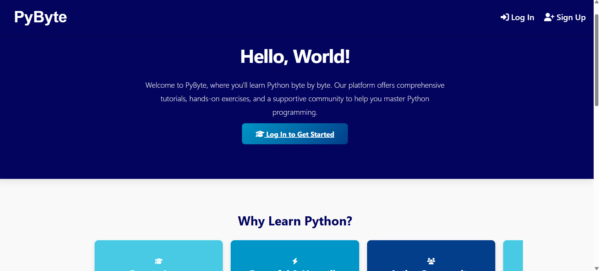
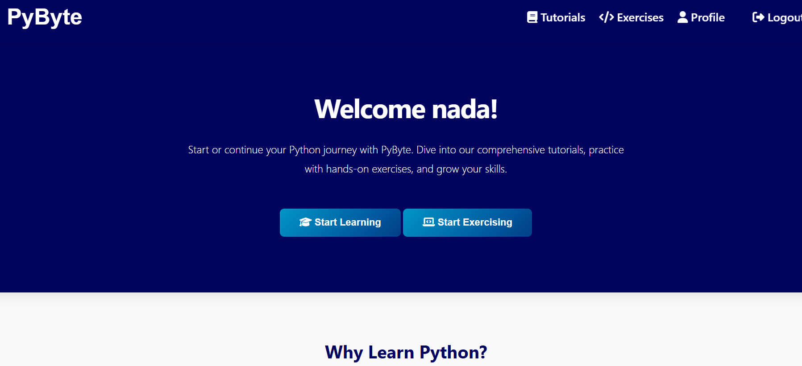
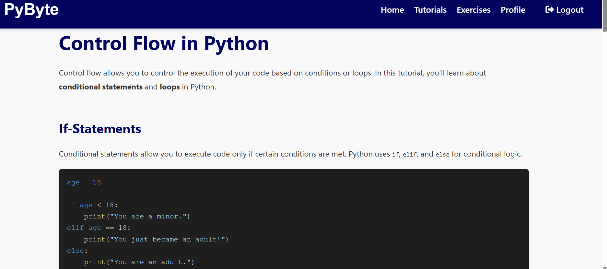
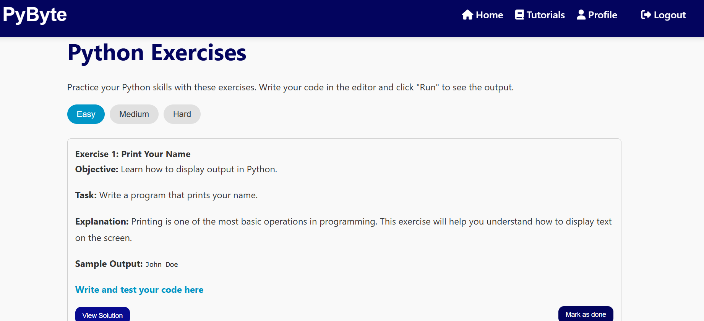
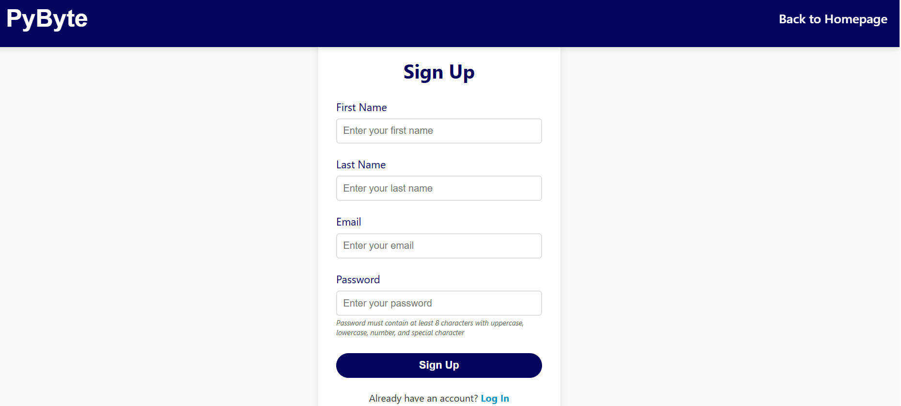

# PyByte 

PyByte is an educational web platform designed to help users learn Python through **tutorials, quizzes, and interactive exercises**.

The platform covers topics from Python fundamentals and data structures to functions, error handling, and Object-Oriented Programming.

##  Features

*  Structured Python tutorials
*  Quizzes and interactive exercises
*  Learning progress tracking
*  Continue Learning from the last completed topic
*  User registration, login, and profile management
*  Tutorial search with partial input
*  View solutions for exercises
*  Mark tutorials and exercises as completed
*  Credential and duplicate-email validation
*  Interactive navigation and user-friendly interface

## Technologies

* **Frontend:** HTML, CSS, JavaScript, jQuery, AJAX
* **Backend:** PHP
* **Database:** MySQL
* **Development Environment:** XAMPP

## Architecture

```text
Frontend → PHP Backend → MySQL Database
```

AJAX is used to update tutorial progress without reloading the page, while jQuery handles interactive exercise features such as completion tracking and solution display.

## Screenshots

### Homepage





### Learning Material



### Exercises



### Sign Up



## Project Structure

```text
PyByte/
├── website/
│   ├── PHP & HTML files
│   ├── styles.css
│   ├── script.js
│   └── images/
│
├── database/
│   └── pybyte.sql
│
├── screenshots/
│   ├── home1.png
│   ├── home2.png
│   ├── material.png
│   ├── exercises.png
│   └── signup.png
│
└── README.md
```

## Getting Started

1. Install **XAMPP**.
2. Start **Apache** and **MySQL**.
3. Place the project inside the `htdocs` folder.
4. Import the MySQL database using phpMyAdmin.
5. Open the project at:

```text
http://localhost/PyByte/
```

---

**PyByte — Learn Python, Byte by Byte.**
